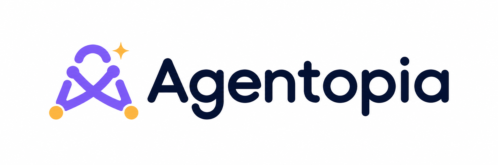

<p align="center"></p>

# Agentopia

A virtual company staffed by AI employees. You own the company, hire
employees with real prompts and skills, give work to an AI manager, and watch
real execution happen in a living top-down office. Employees learn from
official docs and GitHub on a schedule, and remember what they actually did.

Docs: [architecture](docs/architecture.md) · [API](docs/api.md) ·
[integrations research](docs/integrations-research.md) ·
[design research](docs/design-research.md) ·
[implementation plan](docs/implementation-plan.md) ·
[security](docs/security.md) · [local runner](docs/local-runner.md) ·
[final report](docs/final-report.md)

Design docs: [frontend refactor report](docs/design/frontend-refactor-report.md) ·
[refactor plan](docs/design/frontend-refactor-plan.md) ·
[brand system](docs/design/agentopia-brand-system.md) ·
[competitor research](docs/design/competitor-research.md) ·
[design directions](docs/design/design-directions.md) ·
[information architecture](docs/design/marketing-information-architecture.md) ·
[SEO](docs/design/seo-strategy.md) · [motion](docs/design/motion-guidelines.md) ·
[accessibility](docs/design/accessibility-review.md) ·
[performance](docs/design/performance-results.md) ·
[research artifact](artifacts/agentopia-frontend-refactor/index.html)

## Quick start (local)

Requirements: Node 22, pnpm 10, PostgreSQL 16+ and Redis 7+ (or Docker).

```bash
cp .env.example .env            # edit DATABASE_URL / secrets
docker compose up -d            # optional: Postgres on :5434, Redis on :6380
pnpm install
pnpm db:deploy                  # apply migrations
pnpm db:generate
pnpm db:seed                    # demo building + global skill templates
pnpm dev                        # web on :3000 + worker
```

Open http://localhost:3000. The visitor demo is at `/demo` and needs no
account or provider key. To run real tasks, sign up, create a company, and
connect an Anthropic or OpenAI **API key** in Integrations (a Claude or
ChatGPT subscription is not an API key; see the integrations research doc).

## Workspace layout

| Path | What |
| --- | --- |
| `apps/web` | Next.js 16 app: UI, REST API, SSE events, auth |
| `apps/worker` | BullMQ workers: manager orchestration, execution, learning, maintenance |
| `apps/runner` | Optional local runner that executes jobs on your machine |
| `packages/db` | Prisma schema, migrations, seed |
| `packages/core` | Domain logic: providers, orchestration, learning, memory, crypto |
| `packages/shared` | Browser-safe contracts: enums, zod schemas, role templates |

## Scripts

`pnpm dev`, `pnpm build`, `pnpm typecheck`, `pnpm test` (vitest, needs the
database), `pnpm test:e2e` (Playwright), `pnpm db:*`, `pnpm runner`.
